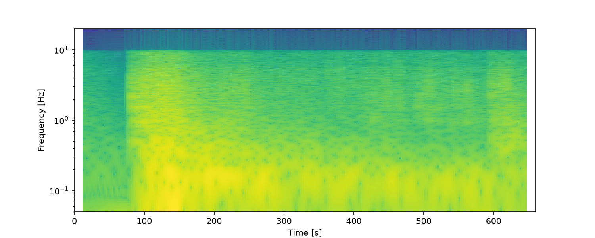

# obspy-earthquake-tutorial

ObsPyを用いて地震波データを操作するチュートリアルです。

Qiita の記事「Pythonで地震を解析するならObsPy。地震波形の取得から可視化・周波数解析まで」のサンプルコードです。
2024年1月1日の能登半島地震（M7.5）を、長野県・松代の観測点（IU.MAJO）で記録した波形を使います。



## 環境構築

```bash
python3 -m venv .venv
source .venv/bin/activate      # Windows は .venv\Scripts\activate
pip install -r requirements.txt
```

## 実行

このフォルダで、番号の順に実行してください。

```bash
python 01_fetch_data.py   # 地震の情報と波形をダウンロード → data/
python 02_plot.py         # 波形をグラフにして、P波・S波の到着時刻を重ねる
python 03_preprocess.py   # 揺れの大きさを速度 [m/s] に直す・フィルタ
python 04_spectrum.py     # FFT とスペクトログラムで周波数を調べる
```

図は `fig/` に保存されます。

| スクリプト | 出力される図 |
| --- | --- |
| `02_plot.py` | `01_raw_stream.png`, `02_bhz_with_taup.png` |
| `03_preprocess.py` | `03_velocity.png`, `03_bandpass.png` |
| `04_spectrum.py` | `04_fft.png`, `04_spectrogram.png` |

## データについて

- 震源情報: [USGS](https://earthquake.usgs.gov/)
- 波形・観測点情報: [EarthScope](https://www.earthscope.org/)（旧 IRIS）の FDSN Web Service

データはスクリプトの実行時にダウンロードするため、リポジトリには含めていません。

## 動作確認環境

- Python 3.14
- ObsPy 1.5.1
